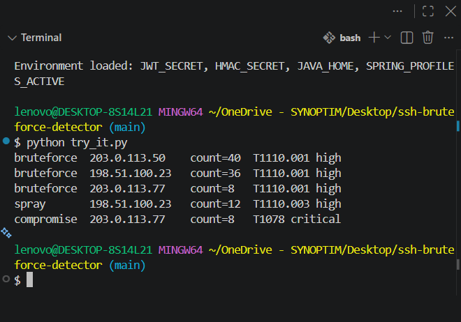

# SSH Brute-Force Detector

A small Python tool that reads an SSH `auth.log`, turns raw lines into structured events and detects three kinds of suspicious activity: **brute force**, **password spraying** and **post-compromise logins**. Alerts are mapped to [MITRE ATT&CK](https://attack.mitre.org/) techniques.


<!-- TODO: replace with your own screenshot: take it from your terminal after running analyzer.py, save it as docs/demo.png -->


## What it detects

| Rule | Logic | MITRE ATT&CK |
|---|---|---|
| **Brute force** | One IP reaches *N* failed logins inside a sliding window of *T* minutes (default 5 in 10 min) | T1110.001 Password Guessing |
| **Password spraying** | One IP fails against *K* or more distinct usernames (default 5) | T1110.003 Password Spraying |
| **Compromise** | A successful login from an IP that was already flagged and had earlier failures | T1078 Valid Accounts |

## Quick start

```bash
git clone https://github.com/imane123332/ssh-bruteforce-detector.git
cd ssh-bruteforce-detector

python gen_sample_log.py > samples/auth.log        # regenerate the sample log 
python analyzer.py --log samples/auth.log --year 2026
```


### Options

| Option | Default | Meaning |
|---|---|---|
| `--log FILE` | required | path to the `auth.log` file |
| `--threshold N` | 5 | failed logins that trigger a brute-force alert |
| `--window T` | 10 | window size in minutes |
| `--min-users K` | 5 | distinct usernames that trigger a spray alert |
| `--year YYYY` | current year | syslog lines carry no year, so it is supplied here |
| `--json FILE` | off | also save the alerts as JSON |

## Example output

```
Parsed 125 SSH events from samples/auth.log

TYPE        IP               COUNT  FIRST SEEN           LAST SEEN            MITRE      SEVERITY
-------------------------------------------------------------------------------------------------
bruteforce  203.0.113.50     40     2026-10-19 08:15:00  2026-10-19 08:16:22  T1110.001  high
bruteforce  198.51.100.23    36     2026-10-19 08:40:00  2026-10-19 08:51:14  T1110.001  high
bruteforce  203.0.113.77     8      2026-10-19 09:30:00  2026-10-19 09:30:17  T1110.001  high
spray       198.51.100.23    12     2026-10-19 08:40:00  2026-10-19 08:51:14  T1110.003  high
compromise  203.0.113.77     8      2026-10-19 09:30:00  2026-10-19 09:30:21  T1078      critical
```

The legitimate user `192.168.1.10` (3 logins, 1 typo) is correctly **not** flagged.

## How it works

```
auth.log ──> parser.py ──> events (dicts) ──> detectors.py ──> alerts ──> analyzer.py (table / JSON)
```

1. **`parser.py`**: regular expressions extract timestamp, IP, username and outcome (`failed`, `accepted`, `invalid_user`) from `sshd` lines. Both classic syslog and ISO 8601 timestamps are supported; irrelevant or malformed lines are skipped.
2. **`detectors.py`**: each rule is a function taking events and returning alerts.
   - *Brute force* groups failed timestamps per IP and slides a `deque` window over them, dropping attempts older than the window. Five failures in one hour is normal; five in ten minutes is not.
   - *Spray* counts distinct usernames per IP with a `set`, because a spray stays under per-account thresholds.
   - *Compromise* looks for an `accepted` event from a flagged IP that happens after its failures.
3. **`analyzer.py`**: command-line interface (`argparse`) that runs everything and prints the table.

## Tuning

Thresholds trade detection against false positives. A low threshold catches slower attackers but flags more legitimate typos; a high one misses them. On the sample log, `--threshold 50` drops all three brute-force alerts and keeps only the password spray. A real deployment should be tuned against its own baseline traffic.

## Tests

```bash
pip install -r requirements.txt
python -m pytest -q
```

16 tests cover the parser (valid, invalid, ISO and malformed lines), each detector (including threshold boundaries, slow attackers and legitimate users) and an end-to-end run on the sample log.

## Limitations

- Syslog timestamps have no year, and a Dec to Jan rollover inside one file is not handled.
- Offline analysis of a single file: no log rotation handling and no real-time monitoring.
- Behind NAT, many users share one IP, which can cause false positives. There is no whitelist yet.
- Only `sshd` password and public-key failures are parsed; other services are ignored.
- Spray detection ignores timing: it counts distinct usernames over the whole file.


